# DSO202 Assignment 1: Three-Tier Task Tracker on Kubernetes

| | |
|---|---|
| **Module** | DSO202: Scaling, Orchestration, Monitoring & Observability (Unit I) |
| **Submitted by** | Dechen Wangdra Sherpa (02230281) |
| **Programme** | BE in Software Engineering, College of Science and Technology, Royal University of Bhutan |
| **Namespace** | `dso202-assignment-01` |
| **Repository** | https://github.com/DechenWangdraSherpa/DSO202-Assignment.git |

---

## 1. Objective

In this assignment I deployed a ready-made three-tier **Task Tracker** (frontend, backend, database) to the `kind` cluster I built in Practical 1. I did not write any application code. The work is all in the Kubernetes configuration: connecting the three tiers, configuring and securing them, limiting their resources, and proving that everything works.

| Learning outcome | Where it is covered |
|---|---|
| LO1: Kubernetes concepts and architecture | Section 4 |
| LO2: Deploying with different resource types | Sections 5.3 to 5.5 |
| LO3: Using `kubectl` and troubleshooting | Sections 6 and 7 |
| LO4: Persistent storage with volumes | Section 5.3 |
| LO5 (part): Namespace multi-tenancy | Sections 5.1 and 5.2 |

---

## 2. Environment

| Item | Value |
|---|---|
| Host OS | Kali Linux, `x86_64` |
| Cluster | `kind` cluster `dso202` from Practical 1 (1 control-plane, 2 workers) |
| Kubernetes | v1.36.1 |
| Cluster config | `DSO202-Practical-01/cluster/kind-cluster.yaml` |
| StorageClass | `standard` (default) |

I used the cluster from Practical 1. Its three nodes are `Ready`, and the control-plane container publishes port `30080` to my laptop (`127.0.0.1:30080->30080/tcp`). This is what lets me open the frontend at `http://localhost:30080`.

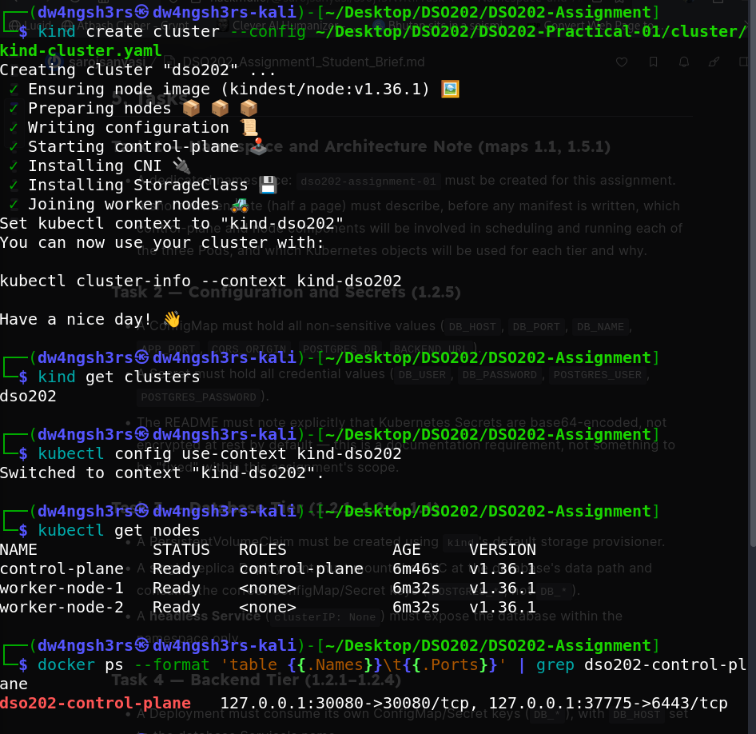

*Figure 1: The cluster created from the Practical 1 config. All three nodes are `Ready` and port 30080 is published.*

---

## 3. Container images

### 3.1 Why I built my own images

The tutor's images (`sarojsanyasi/dso202-*:1.0`) are built for `arm64` only. My laptop is `x86_64` (Figure 3), and a kind node uses the same architecture as its host, so those images cannot run on my machine.

I therefore built the three images from the provided source folders (`db/`, `backend/`, `frontend/`) without changing any code, and published them on my own Docker Hub account. Only the image names are different. Ports and variable names follow the brief.

| Tier | Image | Port |
|---|---|---|
| Frontend | `dwangshers/dso202-amd64-frontend:1.0` | 8080 |
| Backend | `dwangshers/dso202-amd64-backend:1.0` | 8080 |
| Database | `dwangshers/dso202-amd64-db:1.0` | 5432 |

The tag is `1.0` and `latest` is not used. The repositories are public, so other `x86_64` students can pull them without logging in.

### 3.2 How I built them

Before building, I checked the source against the build guide: the backend and frontend run as a non-root `USER`, every folder has a `.dockerignore`, and the backend retries the database connection (`backend/src/db.js`). I tested the whole app locally with `docker compose up --build`, then pushed each image:

```bash
docker buildx build --platform linux/amd64 --provenance=false --sbom=false \
  -t dwangshers/dso202-amd64-<tier>:1.0 --push ./<tier>      # tier = db | backend | frontend
```

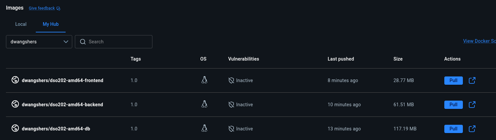

*Figure 2: Docker Hub showing the three images, each with tag `1.0`.*

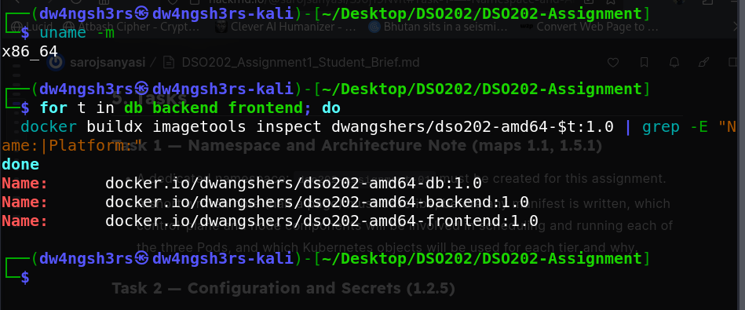

*Figure 3: `uname -m` shows `x86_64`, and `docker buildx imagetools inspect` finds all three published images.*

---

## 4. Architecture note (Task 1)

**How a request travels.** The browser opens `http://localhost:30080`, which reaches the frontend through a NodePort Service. The frontend calls the backend, and the backend talks to PostgreSQL through the database Service.

```
Browser -> frontend-svc (NodePort 30080) -> Frontend Pod (nginx, :8080)
                                              | BACKEND_URL = http://backend-svc:8080
                                              v
           backend-svc (ClusterIP) -> Backend Pod (REST API, :8080)
                                              | DB_HOST = db-svc
                                              v
           db-svc (headless) -> Database Pod (PostgreSQL, :5432) -> PVC db-pvc (1Gi)
```

**Which components start each Pod** (the same steps apply to all three):

| Component | Role |
|---|---|
| **kube-apiserver** | Receives `kubectl apply`, checks it, and applies the ResourceQuota and LimitRange rules. |
| **etcd** | Stores all the objects (Deployments, Pods, Services, ConfigMap, Secret, PVC). |
| **kube-controller-manager** | The Deployment controller creates a ReplicaSet, which creates the Pod. It also binds the PVC. |
| **kube-scheduler** | Chooses a worker node for each Pod. The control-plane node is tainted, so Pods go to the workers. |
| **kubelet** | On the worker: pulls the image, mounts the PVC, passes in the ConfigMap and Secret values, and starts the container. |
| **kube-proxy** | Sets up the Service rules so traffic reaches the right Pods. |
| **CoreDNS** | Resolves Service names such as `backend-svc` and `db-svc`. |

**Objects used for each tier, and why:**

| Tier | Objects | Why |
|---|---|---|
| Database | Deployment (1 replica, `Recreate`), PVC, headless Service | The data must survive a Pod replacement, so it sits on a PVC. `Recreate` stops two Pods using one volume. A headless Service gives a DNS name inside the namespace and nothing outside. |
| Backend | Deployment, ClusterIP Service | The backend keeps no data, so a Deployment can replace it any time. ClusterIP keeps it inside the cluster. |
| Frontend | Deployment, NodePort Service | It is the only tier that needs to be reached from my laptop. |
| Shared | Namespace, ConfigMap, Secret, ResourceQuota, LimitRange | Separation, configuration kept out of the images, credentials kept apart, and resource limits. |

---

## 5. Implementation

All manifests are in the `k8s/` folder, split by tier. Each file has a header comment, and every object has the same labels.

```
DSO202-Assignment/
├── backend/  db/  frontend/      # provided source, unchanged
├── k8s/
│   ├── 00-namespace.yaml
│   ├── 01-quota-and-limits.yaml
│   ├── 02-configmap.yaml
│   ├── 03-secret.yaml
│   ├── database/   00-pvc.yaml  01-deployment.yaml  02-service.yaml
│   ├── backend/    00-deployment.yaml  01-service.yaml
│   └── frontend/   00-deployment.yaml  01-service.yaml
├── evidence/screenshots/assignment01/
└── DSO202_Assignment1_Report.md
```

**Labels on every object:** `app: task-tracker`, `tier: frontend | backend | database`, `dso202/assignment: "01"`, `dso202/managed-by: declarative`.

### 5.1 Namespace, ConfigMap and Secret (Tasks 1 and 2)

All resources are in `dso202-assignment-01`. The ConfigMap `app-config` holds non-sensitive values and the Secret `app-secret` holds credentials.

| Variable | Used by | Stored in | Value |
|---|---|---|---|
| `DB_HOST` | Backend | ConfigMap | `db-svc` |
| `DB_PORT` | Backend | ConfigMap | `5432` |
| `DB_NAME` | Backend | ConfigMap | `taskdb` |
| `APP_PORT` | Backend | ConfigMap | `8080` |
| `CORS_ORIGIN` | Backend | ConfigMap | `*` |
| `POSTGRES_DB` | Database | ConfigMap | `taskdb` |
| `BACKEND_URL` | Frontend | ConfigMap | `http://backend-svc:8080` |
| `DB_USER`, `DB_PASSWORD` | Backend | Secret | not shown |
| `POSTGRES_USER`, `POSTGRES_PASSWORD` | Database | Secret | same values as `DB_USER`, `DB_PASSWORD` |

**`DB_*` and `POSTGRES_*`.** The backend reads `DB_*` names, but the official PostgreSQL image reads `POSTGRES_*` names. I supplied both sets with matching values, and each Deployment uses only its own keys.

> **Secret note.** Kubernetes Secrets are only **base64-encoded**, not encrypted at rest by default. Anyone who can read the Secret can decode it. This is a known limitation and is outside the scope of this assignment.

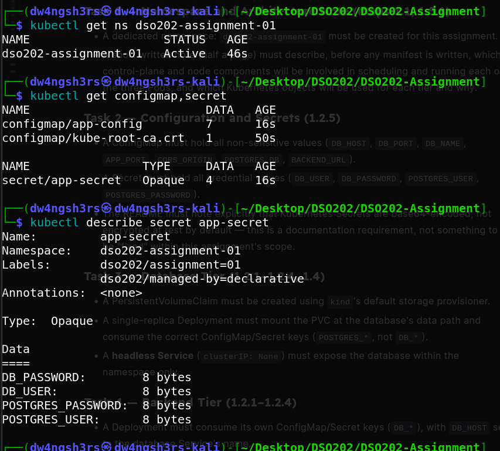

*Figure 4: The namespace is `Active`, `app-config` has 7 keys, and `app-secret` has 4 keys. `describe` shows only the sizes, not the values.*

### 5.2 ResourceQuota and LimitRange (Task 6)

I applied both before any Deployment. Once the quota limits CPU and memory, every container must declare its requests and limits, and the LimitRange fills them in if a container does not.

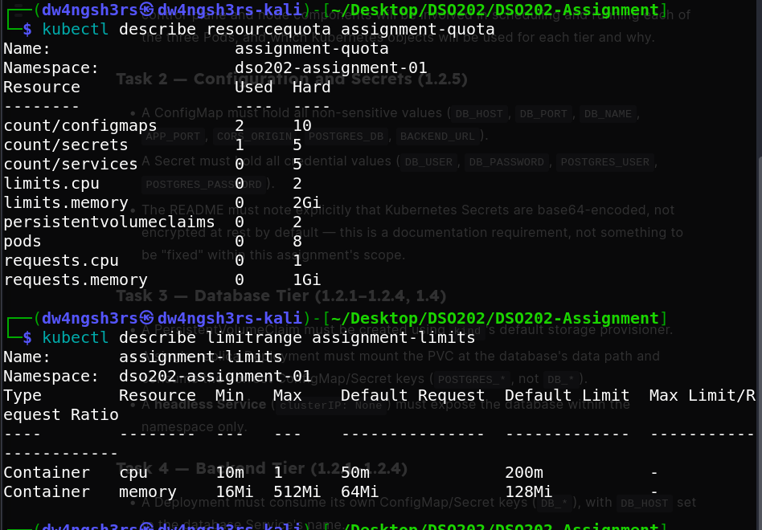

*Figure 5: The quota's hard limits and the LimitRange values. Usage is `0` because nothing was deployed yet.*

**How I chose the values.** The three Deployments declare:

| Tier | Requests (CPU / memory) | Limits (CPU / memory) |
|---|---|---|
| Database | 100m / 256Mi | 500m / 512Mi |
| Backend | 100m / 128Mi | 250m / 256Mi |
| Frontend | 50m / 64Mi | 100m / 128Mi |
| **Total** | **250m / 448Mi** | **850m / 896Mi** |

| Quota | Value | Reason |
|---|---|---|
| `requests.cpu` | 1 | About four times what is requested, so there is room for an extra Pod during an update. |
| `requests.memory` | 1Gi | About twice the 448Mi requested. |
| `limits.cpu` | 2 | Higher than requests, because limits can be over-committed. 850m is used. |
| `limits.memory` | 2Gi | About twice the 896Mi of limits. |
| `pods` | 8 | 3 needed, the rest is spare for updates and the self-healing test. |
| `persistentvolumeclaims` | 2 | 1 needed, 1 spare. |
| `count/services` | 5 | 3 used. |
| `count/configmaps` | 10 | Includes the automatic `kube-root-ca.crt` and leaves room for the Task 7d ConfigMap. |
| `count/secrets` | 5 | 1 used. |

| LimitRange | Value | Reason |
|---|---|---|
| Default request | 50m / 64Mi | Enough for a small container such as nginx. |
| Default limit | 200m / 128Mi | Stops a container without limits from using too much. |
| Min | 10m / 16Mi | Below this, containers tend to fail. |
| Max | 1 CPU / 512Mi | The memory max equals the database limit, since PostgreSQL is the biggest container. |

### 5.3 Database tier (Task 3)

* **PVC `db-pvc`:** 1Gi, `ReadWriteOnce`, from kind's default `standard` StorageClass.
* **Deployment `database`:** 1 replica with the `Recreate` strategy. The PVC is mounted at `/var/lib/postgresql/data`. `POSTGRES_DB` comes from the ConfigMap, and `POSTGRES_USER` and `POSTGRES_PASSWORD` come from the Secret. `PGDATA` points to a sub-folder of the mount so PostgreSQL does not trip over the volume's root folder.
* **Service `db-svc`:** headless (`clusterIP: None`), port 5432, inside the namespace only.

The PVC stayed `Pending` until the Pod was scheduled. This is normal for kind.

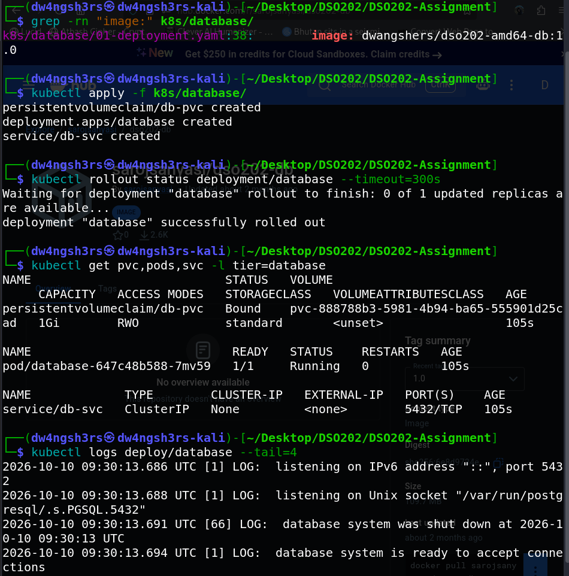

*Figure 6: The image line shows my amd64 database image. The PVC is `Bound`, the Pod is `1/1 Running`, `db-svc` has CLUSTER-IP `None`, and the log says "database system is ready to accept connections".*

### 5.4 Backend tier (Task 4)

* **Deployment `backend`:** 1 replica. `DB_HOST`, `DB_PORT`, `DB_NAME`, `APP_PORT` and `CORS_ORIGIN` come from the ConfigMap, and `DB_USER` and `DB_PASSWORD` come from the Secret. `DB_HOST` is `db-svc`.
* **Service `backend-svc`:** `ClusterIP` on port 8080, reachable only inside the cluster.

The backend retries the database connection by itself, so it does not matter which Pod starts first.

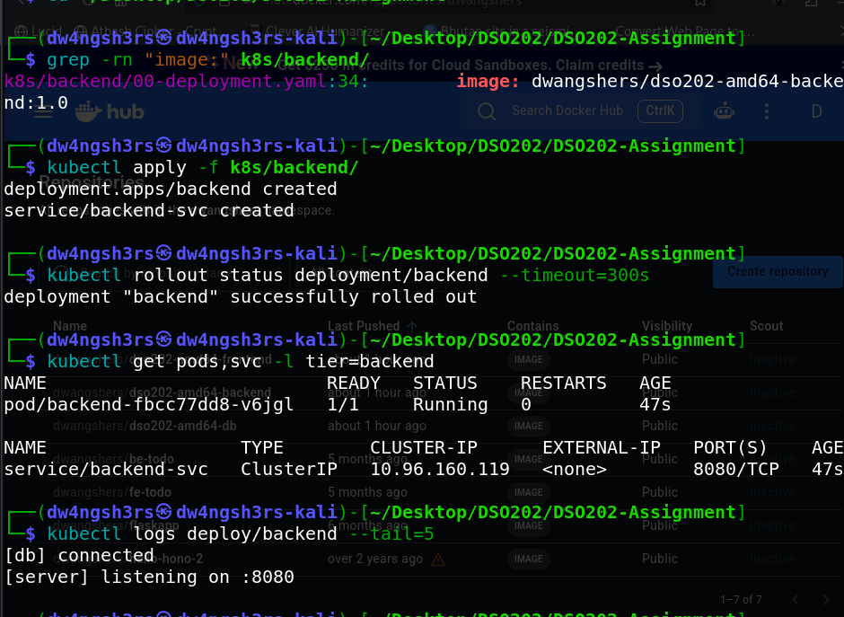

*Figure 7: The backend Pod is `1/1 Running`, `backend-svc` is a ClusterIP Service, and the log shows `[db] connected` and `[server] listening on :8080`.*

### 5.5 Frontend tier (Task 5)

* **Deployment `frontend`:** 1 replica. `BACKEND_URL` comes from the ConfigMap, and the image writes it into `config.js` when the container starts, so no address is fixed inside the image.
* **Service `frontend-svc`:** `NodePort` with `nodePort: 30080`, matching the cluster's port mapping.

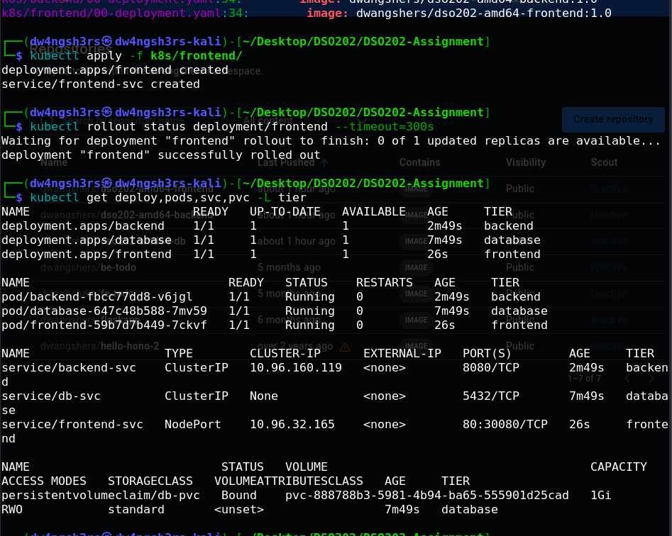

*Figure 8: All three Deployments are `1/1` and every object has a `TIER` label. `db-svc` is headless, `backend-svc` is `ClusterIP`, `frontend-svc` is `NodePort 80:30080/TCP`, and the PVC is `Bound`. Only the frontend is exposed outside the cluster.*

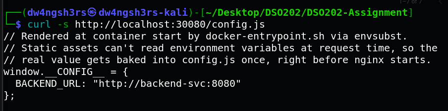

*Figure 9: `curl http://localhost:30080/config.js` returns `BACKEND_URL: "http://backend-svc:8080"`, the value from the ConfigMap, written when the container started.*

My browser runs on my laptop and cannot resolve the cluster-internal name `backend-svc`. For the demonstration only, I temporarily mapped `backend-svc` to `127.0.0.1` in `/etc/hosts` and port-forwarded the backend Service. The page then shows "BACKEND + DB ONLINE".

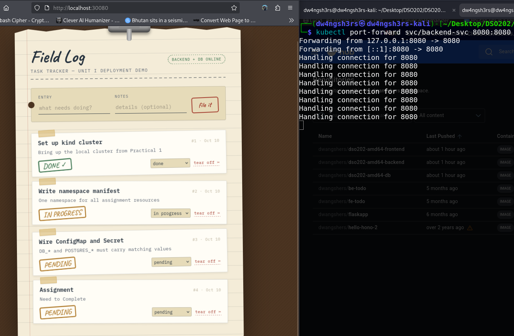

*Figure 10: The Task Tracker at `http://localhost:30080` (left), with the `kubectl port-forward svc/backend-svc 8080:8080` session on the right.*

---

## 6. Verification (Task 7)

### 6.1 (a) Full CRUD cycle

I ran the CRUD cycle with `curl` through a port-forwarded backend (`kubectl port-forward svc/backend-svc 8080:8080`) and checked the result in the frontend.

| Operation | Request | Result |
|---|---|---|
| Status | `GET /api/status` | `{"status":"ok","db":"connected"}` |
| **Create** | `POST /api/tasks` | Task `id=5` created |
| **Read** | `GET /api/tasks` | Tasks 1 to 5 returned |
| **Update** | `PUT /api/tasks/5` | Status changed to `done` |
| Read one | `GET /api/tasks/5` | Task 5 returned |
| **Delete** | `DELETE /api/tasks/5` | `HTTP 204` |

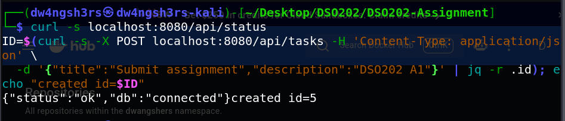

*Figure 11: The status call shows the database is connected, and `POST` creates task 5.*

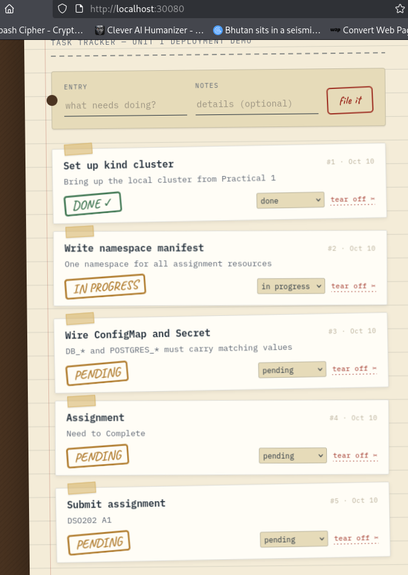

*Figure 12: The frontend shows task #5 as `PENDING`.*

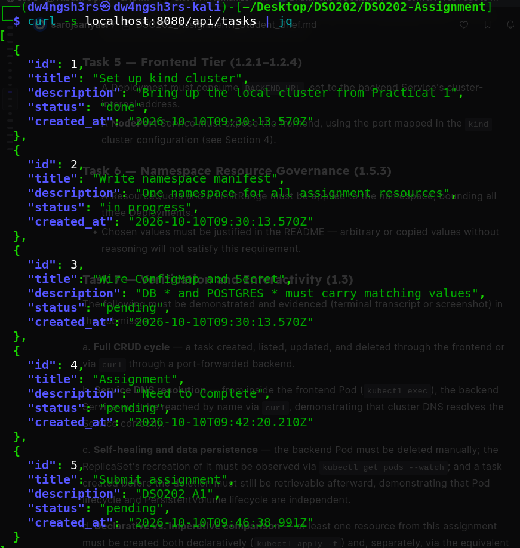

*Figure 13: `GET /api/tasks` returns all five tasks.*

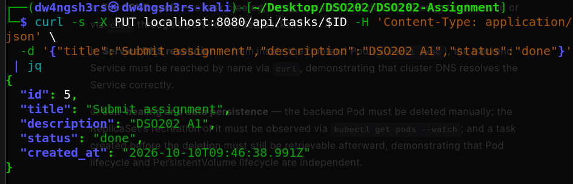

*Figure 14: `PUT /api/tasks/5` returns the task with `"status": "done"`.*

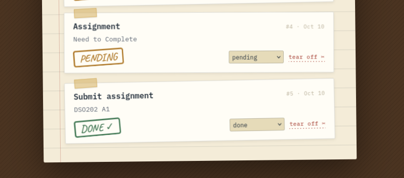

*Figure 15: Task #5 now shows `DONE`.*

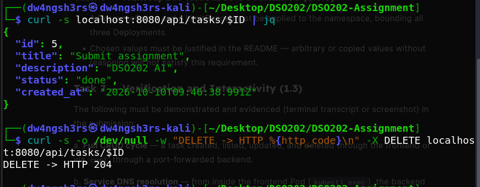

*Figure 16: `GET /api/tasks/5` returns the `done` task, then `DELETE` returns `HTTP 204`.*

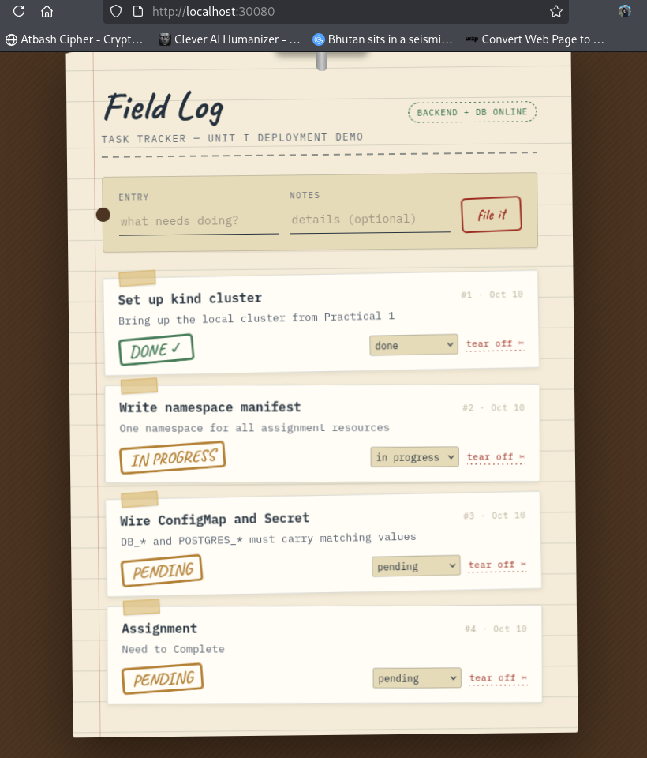

*Figure 17: The frontend shows only tasks 1 to 4, so task 5 is deleted.*

### 6.2 (b) Service DNS from inside a Pod

From inside the frontend Pod, I used `kubectl exec` to look up the backend Service by name and call it:

```bash
kubectl exec deploy/frontend -- sh -c 'nslookup backend-svc; curl -s http://backend-svc:8080/api/status || wget -qO- http://backend-svc:8080/api/status'
```

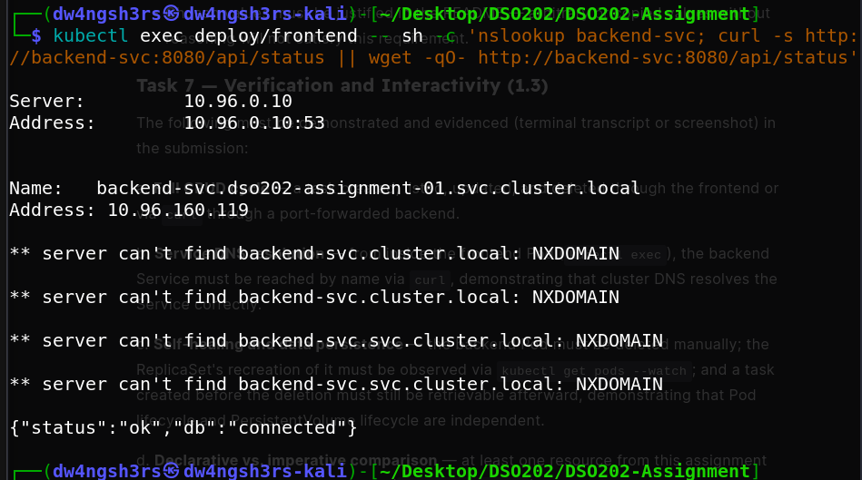

*Figure 18: CoreDNS (`10.96.0.10`) resolves `backend-svc.dso202-assignment-01.svc.cluster.local` to `10.96.160.119`, the same ClusterIP as `backend-svc` in Figures 7 and 8. The request then returns `{"status":"ok","db":"connected"}`.*

The extra `NXDOMAIN` lines are normal. The resolver also tries other search suffixes, which do not exist. The lookup in the Pod's own namespace worked.

### 6.3 (c) Self-healing and data persistence

I first created a task called `survive-pod-deletion` (`id=6`). Then I deleted the backend Pod while watching with `kubectl get pods -l tier=backend --watch` in another terminal.

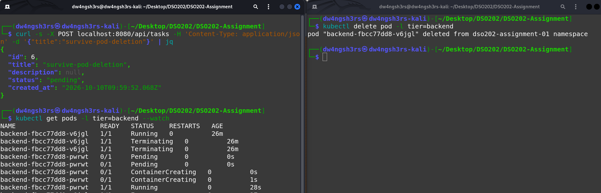

*Figure 19: Task 6 is created (left). The delete removes `backend-fbcc77dd8-v6jgl` (right). The watch shows it `Terminating`, then a new Pod `backend-fbcc77dd8-pwrwt` going through `Pending` and `ContainerCreating` to `Running`.*

The new Pod has the same ReplicaSet name prefix and a new random suffix. The ReplicaSet saw 0 Pods when it wanted 1, and created a replacement on its own.

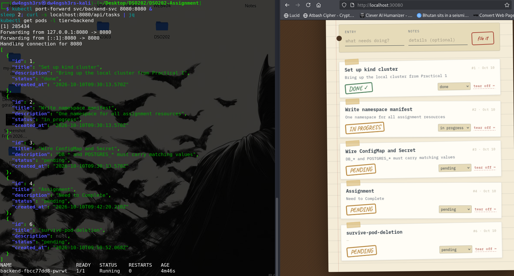

*Figure 20: After I restarted the port-forward, `GET /api/tasks` still returns task 6, and the new Pod is `1/1 Running`. The frontend (right) shows the same task.*

This shows that the backend Pod and the data have separate lifecycles. The task is stored in PostgreSQL on the PVC `db-pvc`, so replacing the backend Pod lost nothing. I only deleted the backend Pod. I did not delete the database Pod, so I have not tested a database restart.

### 6.4 (d) Declarative vs imperative

I created the ConfigMap both ways. `app-config` came from `kubectl apply -f k8s/02-configmap.yaml`. `app-config-imperative` came from `kubectl create configmap ... --from-literal=...` with the same seven keys, and I deleted it afterwards.

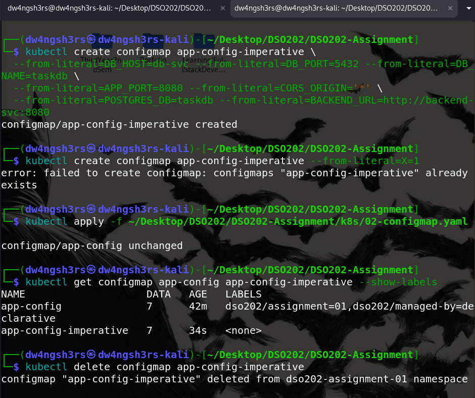

*Figure 21: The imperative `create` works once, then fails with `AlreadyExists`. `apply -f` says `unchanged`. `--show-labels` shows `app-config` with labels and `app-config-imperative` with `<none>`.*

| | Declarative (`apply -f`) | Imperative (`create ...`) |
|---|---|---|
| Record | The YAML file, which can be reviewed and version-controlled | Only the command I typed |
| Running twice | Safe: `unchanged` | Fails: `AlreadyExists` |
| Labels and comments | Included in the file | None, which breaks the brief's labelling rule |
| Rebuilding | `kubectl apply -R -f k8s/` | Re-type every command |
| Best for | Everything that is submitted | Quick tests, or a first draft with `--dry-run=client -o yaml` |

I created all graded resources declaratively. The imperative ConfigMap was only for this comparison.

---

## 7. Problems I met

| Problem | What I found | How I fixed it |
|---|---|---|
| The tutor's images could not run on my laptop | Docker Hub showed only `arm64`, and `uname -m` showed `x86_64` | Built the three images for `linux/amd64` and published them (Section 3) |
| The database Pod went into `ErrImagePull` ("pull access denied") even though the image was listed on the nodes (`crictl images`) | `kubectl describe pod` showed the Pod trying to pull from Docker Hub. I could not find the exact cause | Stopped using `kind load` and let the nodes pull from my public Docker Hub images instead |

---

## 8. Reproducing the deployment

From the project root, with the Practical 1 `dso202` cluster running:

```bash
kubectl apply -f k8s/00-namespace.yaml
kubectl config set-context --current --namespace=dso202-assignment-01
kubectl apply -R -f k8s/
kubectl get deploy,pods,svc,pvc -L tier
curl -s http://localhost:30080/config.js
```

Cleanup:

```bash
kubectl delete namespace dso202-assignment-01
kubectl config set-context --current --namespace=default
```

---

## 9. Conclusion

The Task Tracker runs in its own namespace on my kind cluster. Configuration and credentials are kept in a ConfigMap and a Secret with matching `DB_*` and `POSTGRES_*` values. The database stores its data on a PVC behind a headless Service, the backend is reachable only inside the cluster, and only the frontend is exposed, through a NodePort. A ResourceQuota and LimitRange limit the namespace. The Task 7 evidence shows the app working end to end, Service DNS resolving, the backend Pod being replaced without losing data, and the difference between declarative and imperative management.